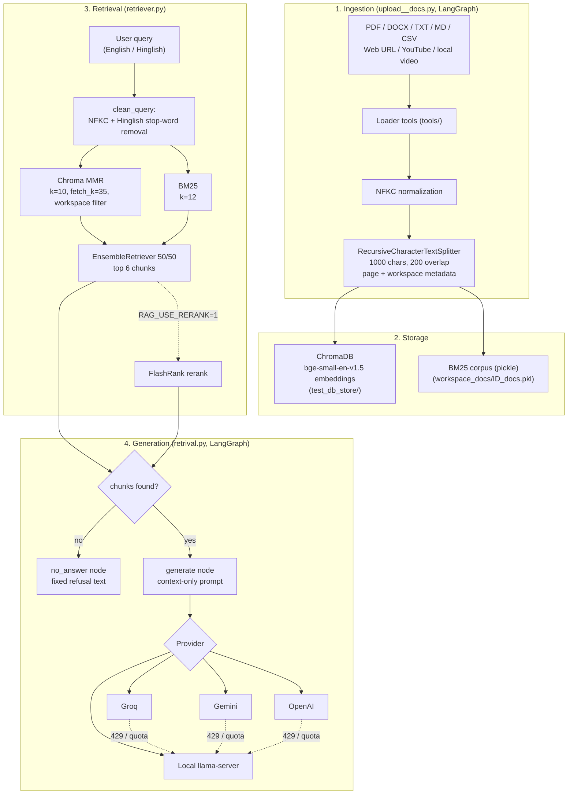

# 🧠 X-Estal Enterprise Hybrid RAG Engine

**A hybrid (BM25 + vector) Retrieval-Augmented Generation system with multi-provider LLM support, a fully offline CPU mode, a document-ingestion pipeline, and a built-in evaluation harness. Works in English and Hinglish.**

<p align="center">
  
  
  
  
  
  
</p>

---

## Table of Contents

- [Highlights](#highlights)
- [Benchmark Results](#benchmark-results)
- [Architecture](#architecture)
- [Quickstart](#quickstart)
- [Choosing an LLM Provider](#choosing-an-llm-provider)
- [Offline CPU Mode](#offline-cpu-mode)
- [Ingesting Your Own Documents](#ingesting-your-own-documents)
- [Running the Evaluation](#running-the-evaluation)
- [Configuration Reference](#configuration-reference)
- [Project Structure](#project-structure)
- [Known Limitations](#known-limitations)
- [Author](#author)

---

## Highlights

- **Hybrid retrieval.** BM25 keyword search and Chroma MMR vector search (`BAAI/bge-small-en-v1.5`) are merged with a 50/50 weighted ensemble. An optional FlashRank reranker is available.
- **Multi-provider generation.** Groq (Llama 3.3 70B), Google Gemini (2.5 Flash), OpenAI (GPT-4o-mini), or a **100% offline** local GGUF model served by `llama-server`. If a cloud provider hits a rate or quota limit, the engine fails over to the local model automatically.
- **Universal ingestion.** PDF, DOCX, TXT/MD/CSV, web articles, YouTube transcripts, and local video, all through one LangGraph load → chunk → store pipeline.
- **Multi-tenant workspaces.** Every chunk carries a `workspace_id`, so documents from different workspaces never mix at query time.
- **Hinglish-aware querying.** Queries are NFKC-normalized and stripped of Hinglish stop-words before retrieval, so mixed-language questions still hit the right chunks. Math symbols in papers are normalized the same way.
- **Context-only answers.** The prompt restricts the model to retrieved context. If retrieval returns nothing, a dedicated `no_answer` node responds with a fixed refusal instead of calling the LLM.
- **Hardened readers.** URL fetching blocks private and internal IP ranges, checks every redirect hop, and caps downloads at 25 MB. Local file access can be confined to a folder with `READER_BASE_DIR`.
- **Built-in benchmark.** A 53-question evaluation set with per-question PASS/FAIL, retrieval-hit tracking, and failure-cause attribution.
- **Streamlit UI.** Chat with page citations, document upload and ingestion, a benchmark scorecard, and an architecture tab.

---

## Benchmark Results

Evaluated on `eval_dataset.json`: 53 questions about the pre-loaded paper *arXiv:2610.30074v1* (48 answerable, 5 out-of-scope), with latency measured on a local CPU. Raw output is in `eval_results.csv` and `eval_summary.json`.

| Metric | Result |
| :--- | :---: |
| Retrieval hit rate (right evidence in retrieved chunks) | **95.8%** (46/48) |
| Out-of-scope questions correctly refused | **100%** (5/5) |
| Hallucinations on out-of-scope questions | **0/5** |
| Answerable accuracy (keyword-match judged) | 37.5% (18/48) |
| Overall pass rate | 43.4% (23/53) |
| False refusals (answer was in the document) | 27.1% (13/48) |
| Execution errors | 0 |
| Latency, avg / median / p95 (local CPU) | 30.5 s / 30.8 s / 44.1 s |

**Reading these numbers honestly:** retrieval is the strong part. Of the 30 failures, **28 were generation failures** (the right chunk was retrieved but the model answered wrongly or refused) and only 2 were retrieval misses. Accuracy by question type: concept 58.3%, factoid 66.7%, reasoning 66.7%, formula 33.3%, numeric 15.8%, table 0%. Using a stronger cloud model for generation is the most direct way to improve these scores. The suite is the right tool to measure that, so run it again with your chosen provider.

---

## Architecture



---

## Quickstart

### 1. Clone and install

```bash
git clone https://github.com/XestalNitish/xestal-enterprise-rag-engine.git
cd xestal-enterprise-rag-engine

python -m venv .venv
source .venv/bin/activate        # Windows: .venv\Scripts\activate

pip install -r requirements.txt
```

Some packages imported by the code are not listed in `requirements.txt`. If you hit an `ImportError`, install them:

```bash
pip install beautifulsoup4 python-docx trafilatura huggingface_hub langchain-text-splitters numpy
# Only if you use these features:
pip install openai-whisper imageio-ffmpeg   # local video transcription
pip install flashrank                       # RAG_USE_RERANK=1
```

### 2. Add API keys (optional, for cloud providers)

Create a `.env` file in the project root (it is git-ignored):

```bash
GROQ_API_KEY=your_groq_key
GEMINI_API_KEY=your_gemini_key      # GOOGLE_API_KEY also works
OPENAI_API_KEY=your_openai_key
```

You can also paste keys into the Streamlit sidebar, or set them in Streamlit secrets when deploying.

### 3. Ingest the sample paper

The repo ships `2610.30074v1.pdf`. The vector store and BM25 index are not committed, so build them once:

```bash
python upload__docs.py
```

This loads the PDF into workspace `ws1` (collection `enterprise_docs`), creating `test_db_store/` and `workspace_docs/ws1_docs.pkl`.

### 4. Ask a question

```bash
# Command line
RAG_PROVIDER=groq python retrival.py "Is paper ka title kya hai?" ws1

# Web UI
streamlit run app.py
```

> Without `RAG_PROVIDER`, the engine defaults to the **local offline model**. See [Offline CPU Mode](#offline-cpu-mode), or set `RAG_PROVIDER` to `groq`, `gemini`, or `openai`.

---

## Choosing an LLM Provider

| Provider | `RAG_PROVIDER` | Default model | Key variable |
| :--- | :--- | :--- | :--- |
| Local (offline) | `local` (default) | Spark-X2.5 GGUF via `llama-server` | none |
| Groq | `groq` | `llama-3.3-70b-versatile` | `GROQ_API_KEY` |
| Gemini | `gemini` | `gemini-2.5-flash` (override with `GEMINI_MODEL`) | `GEMINI_API_KEY` / `GOOGLE_API_KEY` |
| OpenAI | `openai` | `gpt-4o-mini` | `OPENAI_API_KEY` |

In the Streamlit sidebar, pick a provider, optionally change the model name, and press **Activate Model Engine**. If a cloud provider is selected but its key is missing, the engine falls back to the local model.

---

## Offline CPU Mode

Nothing leaves your machine in this mode. The pipeline uses a quantized GGUF model served by [`llama.cpp`](https://github.com/ggml-org/llama.cpp)'s `llama-server`.

1. **Install `llama-server`.** Use a recent llama.cpp build (the launcher uses `-fa on` and `--reasoning` flags). Put the binary on your `PATH`, or in `./llama_bin/`.
2. **Download the model:**

   ```bash
   python download_model.py                 # default: q4_k_m
   python download_model.py --quant q8_0    # larger, higher quality
   python download_model.py --check         # is it already downloaded?
   ```

   Weights come from the Hugging Face repo `XHToken/Spark-X2.5-4B-GGUF` and are saved under `models/` (git-ignored).
3. **Run.** The server starts automatically on `127.0.0.1:8088` the first time the local provider is used.

**Server settings** (see `local_llm_service.py`), tuned for a 6-core desktop CPU:

| Flag | Purpose |
| :--- | :--- |
| `-np 1` | One dedicated slot, avoiding context fragmentation |
| `-fa on` | Flash Attention |
| `-t 6 -tb 6` | Thread count matched to physical cores (change `n_threads` for your CPU) |
| `-c 2048`, `-b 1024`, `-ub 512` | Context, batch, and micro-batch sizes |
| `--reasoning off` | No thinking tokens, for direct answers |

The author reports that on an Intel Core i5-10400, default multi-slot settings timed out beyond 280 s per query, while this configuration answers in about 30 s on average (roughly a 9× improvement). Context is also capped at 3,800 characters (`RAG_MAX_CONTEXT_CHARS`). Your results will vary with hardware.

---

## Ingesting Your Own Documents

**From the UI:** open the **Upload & Ingest Your Data** tab, choose a file, web URL, or YouTube URL, name a workspace, and click **Process & Ingest Document**. Then select that workspace in the chat tab.

**From Python:**

```python
from upload__docs import app as ingest

ingest.invoke({
    "file_path": "my_report.pdf",      # path or URL
    "file_type": "pdf",                # docs | pdf | link | youtube_link | local_video
    "workspace_id": "my_workspace",
    "collection_name": "enterprise_docs",
})
```

```python
import retrival

result = retrival.ask("What are the key findings?", workspace_id="my_workspace")
print(result["answer"])
print(result["sources"])
```

`ask()` returns `{"answer", "sources", "chunks", "status", "error"}`.

---

## Running the Evaluation

The harness imports a module that exposes `ask(question, workspace_id)` (default: `retrival`). Make sure `ws1` is ingested first.

```bash
python eval_rag.py                             # all 53 questions
python eval_rag.py --limit 10                  # first 10 only
python eval_rag.py --ids Q01 Q28 Q49           # specific questions
python eval_rag.py --types table formula       # one question type
python eval_rag.py --delay 2 -v                # throttle for API rate limits, print answers
```

Outputs `eval_results.csv` (per-question answer, PASS/FAIL, retrieval hit, latency, failure cause) and `eval_summary.json` (aggregates by type and difficulty). Each question's correctness is judged by keyword matching against `eval_dataset.json`, so a correct answer worded differently may be marked as a failure.

---

## Configuration Reference

All settings are optional environment variables.

| Variable | Default | Description |
| :--- | :--- | :--- |
| `RAG_PROVIDER` | `local` | `local`, `groq`, `gemini`, or `openai` |
| `GROQ_API_KEY` / `GEMINI_API_KEY` / `OPENAI_API_KEY` | none | Provider credentials |
| `GEMINI_MODEL` | `gemini-2.5-flash` | Gemini model name |
| `RAG_COLLECTION` | `enterprise_docs` | Chroma collection name |
| `RAG_EMBED_MODEL` | `BAAI/bge-small-en-v1.5` | Embedding model |
| `RAG_TOP_N` | `6` | Chunks passed to the LLM |
| `RAG_BM25_K` | `12` | BM25 candidates |
| `RAG_VEC_K` / `RAG_FETCH_K` | `10` / `35` | MMR results / candidate pool |
| `RAG_USE_RERANK` | `0` | Set to `1` for FlashRank reranking |
| `RAG_MAX_CONTEXT_CHARS` | `3800` | Context budget sent to the model |
| `RAG_BASE_DIR` | script folder | Where `test_db_store/` and `workspace_docs/` are looked up |
| `READER_BASE_DIR` | unset | Restrict local file reads to this folder |

---

## Project Structure

```
.
├── app.py                  # Streamlit UI (chat, ingest, benchmark, architecture tabs)
├── retrival.py             # LangGraph RAG pipeline: retrieve → generate / no_answer; ask()
├── retriever.py            # Hybrid BM25 + Chroma MMR retriever, Hinglish query cleaning
├── upload__docs.py         # LangGraph ingestion pipeline: load → chunk → store
├── local_llm_service.py    # llama-server launcher and local chat client
├── download_model.py       # GGUF model downloader (Hugging Face)
├── eval_rag.py             # Evaluation harness
├── eval_dataset.json       # 53 evaluation questions
├── eval_results.csv        # Latest per-question results
├── eval_summary.json       # Latest aggregate metrics
├── 2610.30074v1.pdf        # Sample document for the benchmark
├── database/               # Chunker and Chroma/BM25 storage helpers
├── tools/                  # Loaders: pdf, docx, web, YouTube, video + safe fetch helpers
├── .streamlit/config.toml  # UI theme
└── requirements.txt
```

Generated at runtime and git-ignored: `test_db_store/`, `workspace_docs/`, `models/`, `.env`.

---

## Known Limitations

- **Generation quality with the small local model** is the main bottleneck (see [Benchmark Results](#benchmark-results)), especially for numeric, table, and formula questions.
- **Evaluation is keyword-based**, so it can under-count correct paraphrased answers.
- **BM25 corpora are stored as pickle files.** Only load `workspace_docs/*.pkl` files you created yourself; unpickling untrusted files is unsafe.
- **Local mode needs a separately installed `llama-server`.** The GGUF model is downloaded by the script, but the inference binary is not bundled.
- **Duplicate retriever code.** `retrival.py` uses the root-level `retriever.py`; `database/retriever.py` is an older variant exposed through the `database` package.

---

## Author

**Nitish Kumar** ([@XestalNitish](https://github.com/XestalNitish)), AI engineering student building applied LLM systems.

- GitHub: [github.com/XestalNitish](https://github.com/XestalNitish)
- LinkedIn: [linkedin.com/in/nitish-kumar-33714642b](https://www.linkedin.com/in/nitish-kumar-33714642b/)
- Instagram: [instagram.com/x_estal_nitish](https://www.instagram.com/x_estal_nitish)

---
### 🌟 Other Live projects: by Nitish Kumar
1. 🛠️ **[Code Dev Agent](https://code-dev-agent-by-x-estal-nitish.streamlit.app):** Autonomous multi-file code generation and debugging agent.
2. 🔬 **[Xestal Research Agent](https://xestal-research-agent-by-x-estal-nitish.streamlit.app):** Academic literature synthesis and deep research assistant.
3. 🏥 **[Brain Tumor Classifier](https://brain-tumor-classifier-by-x-estal-nitish.streamlit.app):** Computer vision MRI diagnostic neural network.
4. 📈 **[Bitcoin Price Predictor](https://x-estal-nitish-bit-coin-price-predictor.streamlit.app):** Quantitative crypto time-series forecasting model.

<p align="center"><sub>MIT License · © 2026 Nitish Kumar</sub></p>
