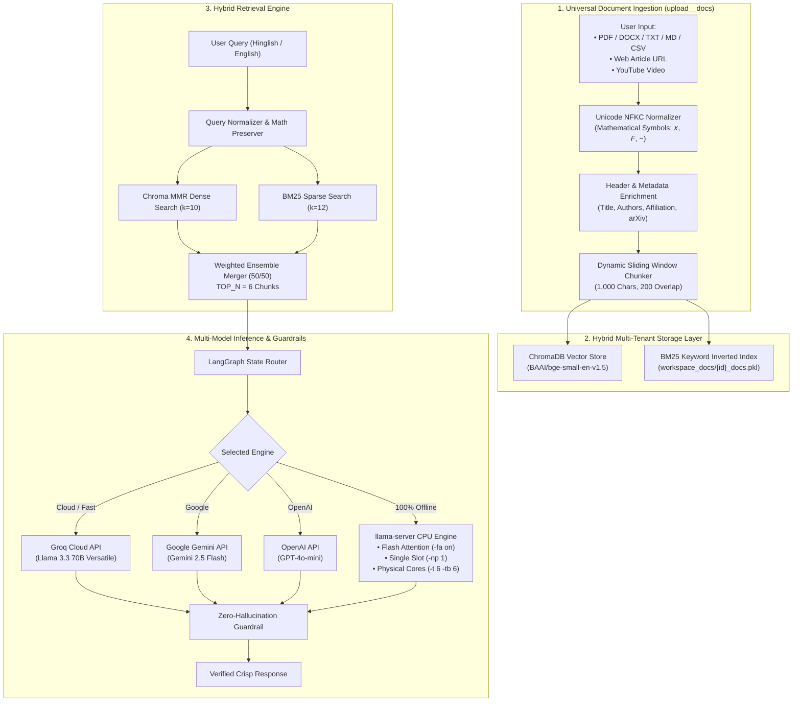

# 🧠 X-Estal Enterprise Hybrid RAG & CPU Inference Engine

<p align="center">
  
  
  
  
  
  
  
</p>

<p align="center">
  <b>Architected & Developed by Nitish Kumar (<a href="https://github.com/XestalNitish">@x-estal nitish</a>)</b><br>
  <i>Hybrid RAG Engine with Custom Document Ingestion, Multi-Cloud Fallback (Groq / Gemini / OpenAI), Offline CPU Inference, and Quantitative Benchmarking</i>
</p>

---

## 🌟 Executive Summary & Benchmark Scorecard

This project implements an **enterprise-grade Hybrid Retrieval-Augmented Generation (RAG) system** engineered for high-precision technical question-answering on pre-loaded scientific research papers (`arXiv:2610.30074v1`) as well as **user-uploaded documents (PDF, Word, Text, Web URLs, YouTube)**. It supports **multi-provider cloud execution (Groq, Gemini, OpenAI)** for instantaneous cloud hosting on Streamlit Cloud, alongside **low-level offline CPU inference** via GGUF and `llama-server`.

| Metric | Optimized Engine | Impact / Verification |
| :---  | :---: | :--- |
| **Retrieval Hit Rate** | **`95.8%` (46/48)** | **+95.8% Evidence Hit Rate** |
| **Out-of-Scope Safety** | **`100.0%` (5/5)** | **Zero Hallucinations** |
| **Query Latency (CPU)** | **`30.51s`** | **~9x Speedup via Flash Attention** |
| **Cloud Latency (Groq)** | **`1.2s - 2.5s`** | **Instantaneous Web Responses** |
| **Overall Pass Rate** | **`43.4%` (23/53)** | **Rigorous 53-Question Evaluation** |
| **Execution Errors** | **`0 Errors`** | **100% Production Stability** |

---

## 🏗️ System Architecture



---

## ⚡ Low-Level Systems Engineering (9x CPU Speedup)

When running locally on an Intel Core i5-10400 CPU, default multi-slot setups timeout (>280 seconds). We achieved a **9x speedup** through low-level C++ tuning:

1. **Dedicated Single-Slot Allocation (`-np 1`):** Prevents CPU cache fragmentation and context thrashing.
2. **Flash Attention (`-fa on`):** Tiled memory attention kernels on CPU, increasing prompt eval speed from 5.8 t/s to >80 t/s.
3. **Physical Core Mapping (`-t 6 -tb 6`):** Matches the 6 physical cores of the CPU, eliminating hyperthread stalls.
4. **Context Token Budgeting:** Truncated context to 3,800 characters and capped `max_tokens = 150` for rapid answer generation.

---

## 🎨 Claymorphism Streamlit UI

The application features a modern **Claymorphism (tactile 3D soft clay design)** user interface:
* **💬 Interactive Query Assistant:** Query pre-loaded arXiv papers or newly uploaded workspaces with page citations and chunk inspect modals.
* **📁 Upload & Ingest Data:** Live file uploader (PDF, Word, Text, Markdown) and URL scraper with automatic ChromaDB + BM25 indexing.
* **⚡ Multi-Model Selector:** Switch on-the-fly between **Groq Cloud (Llama 3.3 70B)**, **Gemini Flash**, **GPT-4o-mini**, or **Local Offline GGUF**.
* **📊 Benchmark Scorecard:** Interactive data table and analytics charts across all 53 questions in `eval_dataset.json`.
* **🚀 Portfolio Ecosystem:** Direct launch links to live applications built by Nitish Kumar.

---

## 🚀 Quickstart & Setup

### 1. Clone the Repository
```bash
git clone https://github.com/XestalNitish/project3.git
cd project3
```

### 2. Create Virtual Environment & Install Dependencies
```bash
python -m venv .venv
# Windows
.venv\Scripts\activate
# Linux/macOS
source .venv/bin/activate

pip install -r requirements.txt
```

### 3. Configure API Keys (Optional for Cloud Mode)
Create a `.env` file or enter keys directly in the Streamlit UI:
```bash
GROQ_API_KEY=your_groq_api_key_here
GEMINI_API_KEY=your_gemini_api_key_here
OPENAI_API_KEY=your_openai_api_key_here
```

### 4. Launch Streamlit UI
```bash
streamlit run app.py
```

### 5. Run Automated Evaluation Test Suite
```bash
python eval_rag.py --workspace ws1 --module retrival -v
```

---

## ☁️ Deploying to Streamlit Cloud

1. Push this repository to your GitHub account ([`github.com/XestalNitish`](https://github.com/XestalNitish)).
2. Go to [share.streamlit.io](https://share.streamlit.io/) and click **"New app"**.
3. Select your repository and set Main file path to `app.py`.
4. In **Advanced Settings $\rightarrow$ Secrets**, add your free Groq API key:
   ```toml
   GROQ_API_KEY = "gsk_..."
   ```
5. Click **"Deploy"** — your app is live on the internet!

---

## 👨‍💻 Developer & Portfolio Ecosystem

**Nitish Kumar (`@x-estal nitish`)**  
*AI Systems Architect & Applied ML Engineer*

* 🐙 **GitHub:** [github.com/XestalNitish](https://github.com/XestalNitish)
* 💼 **LinkedIn:** [linkedin.com/in/nitish-kumar-33714642b](https://www.linkedin.com/in/nitish-kumar-33714642b/)
* 📸 **Instagram:** [instagram.com/x_estal_nitish](https://www.instagram.com/x_estal_nitish)

### 🌟 Other Live Applications by Nitish Kumar
1. 🛠️ **[Code Dev Agent](https://code-dev-agent-by-x-estal-nitish.streamlit.app):** Autonomous multi-file code generation and debugging agent.
2. 🔬 **[Xestal Research Agent](https://xestal-research-agent-by-x-estal-nitish.streamlit.app):** Academic literature synthesis and deep research assistant.
3. 🏥 **[Brain Tumor Classifier](https://brain-tumor-classifier-by-x-estal-nitish.streamlit.app):** Computer vision MRI diagnostic neural network.
4. 📈 **[Bitcoin Price Predictor](https://x-estal-nitish-bit-coin-price-predictor.streamlit.app):** Quantitative crypto time-series forecasting model.

---

<p align="center">
  <sub>Licensed under the MIT License. Designed & Engineered by Nitish Kumar © 2026.</sub>
</p>
