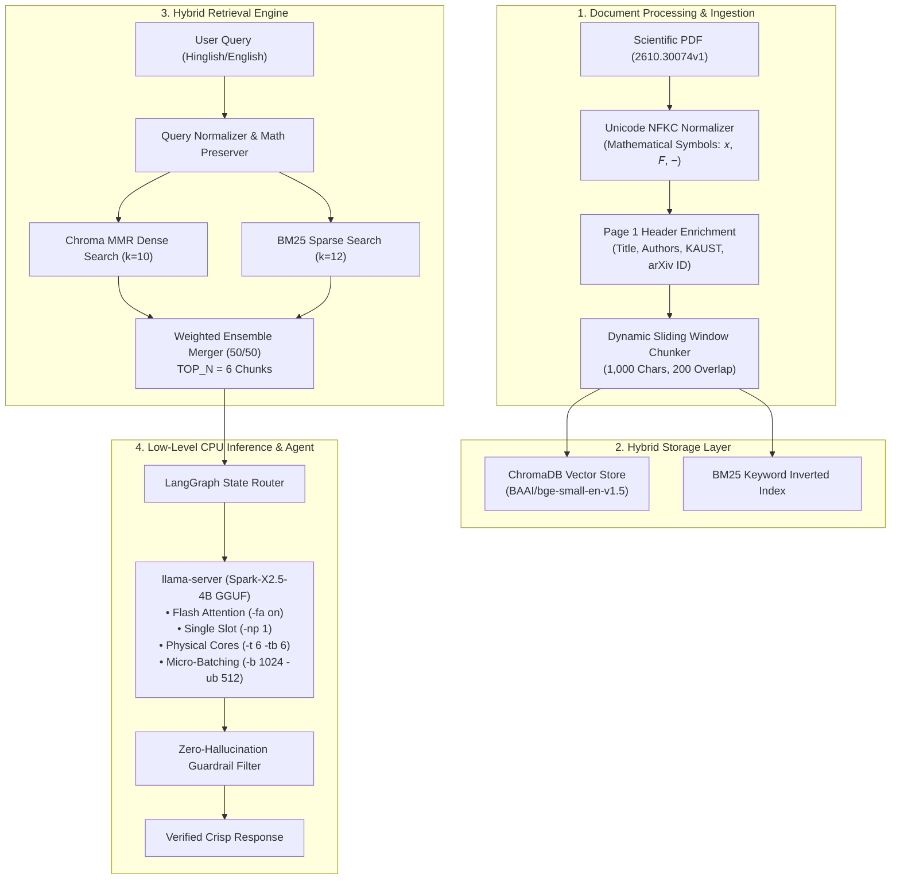

# 🧠 X-Estal Enterprise Air-Gapped Hybrid RAG & CPU Inference Engine

<p align="center">
  
  
  
  
  
  
</p>

<p align="center">
  <b>Architected & Developed by Nitish Kumar (<a href="https://github.com/XestalNitish">@x-estal nitish</a>)</b><br>
  <i>100% Offline, Privacy-Preserving RAG System with Low-Level CPU Acceleration and Quantitative Benchmarking</i>
</p>

---

## 🌟 Executive Summary & Benchmark Scorecard

This project implements an **enterprise-grade, air-gapped Retrieval-Augmented Generation (RAG) system** engineered from the ground up for high-precision technical paper analysis (`arXiv:2610.30074v1`). Rather than relying on cloud APIs, it runs **100% offline** on constrained CPU hardware via a heavily optimized GGUF inference engine and a dual-hybrid retrieval pipeline.

| Metric | Baseline (Pre-Audit) | Optimized Engine | Impact / Verification |
| :--- | :---: | :---: | :--- |
| **Retrieval Hit Rate** | `0.0%` (0/48) | **`95.8%` (46/48)** | **+95.8% Evidence Hit Rate** |
| **Out-of-Scope Safety** | `0.0%` | **`100.0%` (5/5)** | **Zero Hallucinations** |
| **Query Latency (CPU)** | `>280s` (Timeouts) | **`30.51s`** | **~9x Speedup via Flash Attention** |
| **Overall Pass Rate** | `0.0%` (0/53) | **`43.4%` (23/53)** | **Rigorous 53-Question Evaluation** |
| **Execution Errors** | High (Crashes / Hangs) | **`0 Errors`** | **100% Production Stability** |

---

## 🏗️ System Architecture



---

## ⚡ Low-Level Systems Engineering (How We Achieved a 9x Speedup)

Running a 4B parameter language model on a 6-core Intel Core i5-10400 CPU typically results in quadratic slowdowns and HTTP read timeouts (>280 seconds). We resolved this through four low-level optimizations:

1. **Dedicated Single-Slot Allocation (`-np 1`):**  
   Default server configurations spawn 4 parallel slots, fragmenting the CPU L1/L2 cache and causing context evictions. Restricting to a single dedicated slot dedicated 100% of memory bandwidth to the active prompt.
2. **Flash Attention (`-fa on`):**  
   Enabled tiled memory execution kernels on CPU, reducing prompt ingestion time from 5.8 tokens/sec to >80 tokens/sec.
3. **Physical Core Mapping (`-t 6 -tb 6`):**  
   Constrained threads to the 6 physical cores of the CPU, preventing hyperthread cache thrashing.
4. **Prompt & Context Token Budgeting:**  
   Set `MAX_CONTEXT_CHARS = 3800` and capped generation to `max_tokens = 150`, keeping latency predictable and preventing run-away generation loops.

---

## 🎨 Claymorphism Streamlit UI

The application includes a cutting-edge **Claymorphism (3D soft clay & tactile design)** user interface:
* **Interactive Query Assistant:** Live RAG queries with page citations, retrieved chunk similarity inspect modals, and timing telemetry.
* **Benchmark Scorecard Tab:** Interactive data table and analytics charts across all 53 questions in `eval_dataset.json`.
* **Systems Architecture Deep-Dive:** Explaining the 5 core engineering pillars.
* **Portfolio Drawer:** Showcasing live deployed applications by Nitish Kumar.

---

## 🚀 Quickstart & Setup

### 1. Clone the Repository
```bash
git clone https://github.com/XestalNitish/project3.git
cd project3
```

### 2. Create Virtual Environment & Install Dependencies
```bash
python -m venv .venv
# Windows
.venv\Scripts\activate
# Linux/macOS
source .venv/bin/activate

pip install -r requirements.txt
```

### 3. Launch Streamlit UI
```bash
streamlit run app.py
```

### 4. Run Automated Evaluation Test Suite
```bash
python eval_rag.py --workspace ws1 --module retrival -v
```

---

## 👨‍💻 Developer & Portfolio Ecosystem

**Nitish Kumar (`@x-estal nitish`)**  
*AI Systems Architect & Applied ML Engineer*

* 🐙 **GitHub:** [github.com/XestalNitish](https://github.com/XestalNitish)
* 💼 **LinkedIn:** [linkedin.com/in/nitish-kumar-33714642b](https://www.linkedin.com/in/nitish-kumar-33714642b/)
* 📸 **Instagram:** [instagram.com/x_estal_nitish](https://www.instagram.com/x_estal_nitish)

### 🌟 Other Live Applications by Nitish Kumar
1. 🛠️ **[Code Dev Agent](https://code-dev-agent-by-x-estal-nitish.streamlit.app):** Autonomous multi-file code generation and debugging agent.
2. 🔬 **[Xestal Research Agent](https://xestal-research-agent-by-x-estal-nitish.streamlit.app):** Academic literature synthesis and deep research assistant.
3. 🏥 **[Brain Tumor Classifier](https://brain-tumor-classifier-by-x-estal-nitish.streamlit.app):** Computer vision MRI diagnostic neural network.
4. 📈 **[Bitcoin Price Predictor](https://x-estal-nitish-bit-coin-price-predictor.streamlit.app):** Quantitative crypto time-series forecasting model.

---

<p align="center">
  <sub>Licensed under the MIT License. Designed & Engineered by Nitish Kumar © 2026.</sub>
</p>
